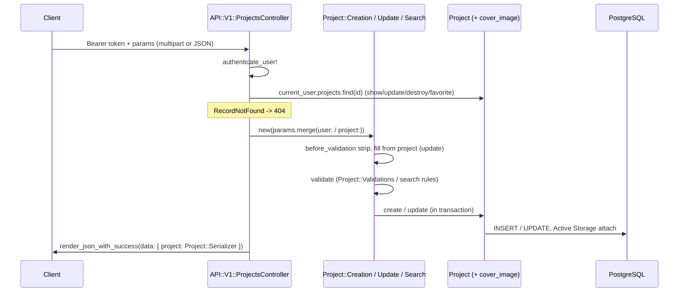

# Projects Design

**Spec**: `.specs/features/projects/spec.md`
**Status**: Approved

---

## Architecture Overview

A `projects` table owned by `users`, one flattened `Project` record, two forms for the rules that can fail (`Project::Creation`, `Project::Update`), one form for the list rules (`Project::Search`), and thin controllers. Show, delete and favorite carry no rule that can fail validation, so their controllers call the record directly, as `Session::RevokesController` does. Search and sort are scopes on `Project`, run in PostgreSQL, reached by request specs.



Alternatives weighed for the list rules:

1. **Scopes on `Project` + `Project::Search` form (chosen)** - the 3-character and sort-value rules sit on a form with ActiveModel errors, so the 422 envelope is the same `render_json_with_model_errors` the rest of the API uses. The SQL is two short scopes.
2. Ransack - in the Gemfile, but accent-insensitive matching needs a custom `ransacker` per column and the whitelist/422 rules still need a form. It buys nothing for three fixed sorts and one search.
3. Filtering in the controller - forbidden by AGENTS.md (no SQL, no conditionals in controllers).

---

## Code Reuse Analysis

### Existing Components to Leverage

| Component | Location | How to Use |
| --------- | -------- | ---------- |
| `ApplicationForm` | `app/models/application_form.rb` | Base of `Project::Creation`, `Project::Update`, `Project::Search` |
| `User::Profile::Update` | `app/models/user/profile/update.rb` | Pattern for authenticated forms: `attr_accessor`, strip in `before_validation`, `update` + `import_errors` + `halt!` |
| `API::V1::BaseController` | `app/controllers/api/v1/base_controller.rb` | `authenticate_user!`, `current_user`, `render_json_with_*`; gains `rescue_from ActiveRecord::RecordNotFound` and `include Pagy::Method` |
| `User::Serializer` | `app/models/user/serializer.rb` | Pattern for `Project::Serializer` |
| `AuthHelpers`, `"an unauthorized API request"` | `spec/support/` | Auth headers and 401 assertions in every request spec |
| `spec/models/user/error_messages_spec.rb` | `spec/models/user/` | Extended to scan `app/models/project/**` so the new `errors.add` keys are checked in both locales |

### Integration Points

| System | Integration Method |
| ------ | ------------------ |
| `users` | `projects.user_id` FK; `User has_many :projects, dependent: :destroy` - deleting an account removes its projects |
| Active Storage | `Project has_one_attached :cover_image`; tables installed with `active_storage:install` (UUID keys from the generator config) |
| PostgreSQL `unaccent` | Enabled in the projects migration; used by `Project.search` |
| Pagy 43 | `Pagy::Method#pagy(:offset, relation, limit: 20)` in the controller; out-of-range pages return an empty page (no `raise_range_error`) - confirmed in `pagy-43.8.1/lib/pagy/modules/abilities/rangeable.rb` |
| Time zone | `config.time_zone = "America/Sao_Paulo"`; forms compare with `Date.current` |

---

## Components

### `Project` (record)

- **Purpose**: Persist a project and expose the list scopes.
- **Location**: `app/models/project.rb`
- **Interfaces**:
  - `belongs_to :user`; `has_one_attached :cover_image`
  - `scope :search, ->(term)` - `unaccent(name) ILIKE unaccent(:pattern) OR unaccent(client_name) ILIKE unaccent(:pattern)`, `pattern = "%#{sanitize_sql_like(term)}%"`
  - `scope :sorted_by, ->(key)` - `order(Project::Sort::ORDERS.fetch(key))`
- **Reuses**: `UserSession` scope style.

### `Project::Sort` and `Project::CoverImage` (domain constants)

- **Location**: `app/models/project/sort.rb`, `app/models/project/cover_image.rb`
- **Interfaces**:
  - `Project::Sort::DEFAULT = "name"`; `ORDERS = { "name" => "LOWER(projects.name) ASC, projects.id ASC", "recent_start" => "projects.start_date DESC, LOWER(projects.name) ASC, projects.id ASC", "nearest_deadline" => "projects.end_date ASC, LOWER(projects.name) ASC, projects.id ASC" }` (wrapped in `Arel.sql`)
  - `Project::CoverImage::CONTENT_TYPES = %w[image/jpeg image/png]`; `MAX_SIZE = 5.megabytes`

### `Project::Validations` (shared form rules)

- **Purpose**: The field rules both create and update enforce, in one place.
- **Location**: `app/models/project/validations.rb` (`ActiveSupport::Concern`, included by the two forms)
- **Rules**: presence of name, client_name, start_date, end_date; length ≤ 255; `name.split.size >= 2` else `errors.add(:name, :two_words)`; `end_date < start_date` → `errors.add(:end_date, :before_start_date)`; cover present → content type sniffed with `Marcel::MimeType.for(file)` in `CONTENT_TYPES` else `errors.add(:cover_image, :content_type)`, `file.size > MAX_SIZE` → `errors.add(:cover_image, :file_size)`; a cover that is not an uploaded file → `:content_type`.

### `Project::Creation` (form)

- **Location**: `app/models/project/creation.rb`
- **Interfaces**: attributes `name`, `client_name`, `start_date :date`, `end_date :date`, `cover_image`; `attr_accessor :user, :project`; `persist` → `self.project = user.projects.create(...)`, `import_errors` + `halt!` on failure.

### `Project::Update` (form)

- **Location**: `app/models/project/update.rb`
- **Interfaces**: same attributes; `attr_accessor :project`; records the keys it was given in `initialize`; `before_validation` fills the keys not given from `project`; `persist` → `project.update(given attributes)`, `import_errors` + `halt!` on failure.

### `Project::Search` (form)

- **Location**: `app/models/project/search.rb`
- **Interfaces**: attributes `search`, `sort`; `attr_accessor :user`; strips `search`; `validates :search, length: { minimum: 3 }, allow_blank: true`; `validates :sort, inclusion: { in: Project::Sort::ORDERS.keys }`, default `Project::Sort::DEFAULT`; `results` → `user.projects.with_attached_cover_image`, `.search(search)` when present, `.sorted_by(sort)`. Never saved - the controller branches on `valid?`.

### `Project::Serializer`

- **Location**: `app/models/project/serializer.rb`
- **Interfaces**: attributes `id, name, client_name, start_date, end_date, favorite`, `cover_image_url` (`rails_blob_url(cover_image)` when attached, else `nil`). URL host from `Rails.application.routes.default_url_options`, set from `action_mailer.default_url_options` in `config/initializers/default_url_options.rb`.

### Controllers

- `API::V1::ProjectsController` (`app/controllers/api/v1/projects_controller.rb`): `index` (Search → `pagy` → `data: { projects:, pagination: { page, pages, count, limit } }`), `show`, `create` (201), `update`, `destroy` (`project.destroy!`, 200 with message). Strong params: `params.permit(:name, :client_name, :start_date, :end_date, :cover_image)`.
- `API::V1::Project::FavoritesController` (`app/controllers/api/v1/project/favorites_controller.rb`): `create` → `project.update!(favorite: true)`, `destroy` → `project.update!(favorite: false)`, both 200 with the project.
- Routes: `resources :projects, only: %i[index show create update destroy] do resource :favorite, only: %i[create destroy], module: :project end`.

---

## Data Models

### `projects`

```ruby
create_table :projects, id: :uuid do |t|
  t.references :user, type: :uuid, null: false, foreign_key: true, index: true
  t.string :name, null: false
  t.string :client_name, null: false
  t.date :start_date, null: false
  t.date :end_date, null: false
  t.boolean :favorite, null: false, default: false
  t.timestamps
end
```

**Relationships**: `User has_many :projects, dependent: :destroy`; `Project belongs_to :user`; `Project has_one_attached :cover_image` (purged when the project is destroyed or the image replaced - Active Storage default).

---

## Error Handling Strategy

| Error Scenario | Handling | User Impact |
| -------------- | -------- | ----------- |
| Missing / foreign project id | `rescue_from ActiveRecord::RecordNotFound` in `BaseController` | 404, `message: I18n.t("api.errors.not_found")` |
| Field rule broken | Form error → `render_json_with_model_errors` | 422 with `details.<field>` |
| Search < 3 chars / unknown sort | `Project::Search` invalid → `render_json_with_model_errors` | 422 with `details.search` / `details.sort` |
| No / bad token | `authenticate_user!` | 401 |
| Infrastructure failure | Existing `rescue_from StandardError` | 500 |

---

## Risks & Concerns

| Concern | Location (file:line) | Impact | Mitigation |
| ------- | -------------------- | ------ | ---------- |
| `RecordNotFound` falls into `rescue_from StandardError` | `app/controllers/api/v1/base_controller.rb:4` | A missing project would answer 500 | Add `rescue_from ActiveRecord::RecordNotFound` → 404 (T6) |
| `unaccent()` is not `IMMUTABLE`, so no expression index | `Project.search` | Search scans the user's rows | Always scoped by `user_id` (indexed); per-user volume is small. Revisit with an immutable wrapper + trigram index if it grows |
| Client-declared content type can lie | `Project::Validations` | A non-image renamed `.png` | Type sniffed from the bytes with Marcel, not from the header |
| `i18n-tasks health` is already red (unused `*.failure` keys) | `config/locales/user/*.yml` | Build gate would be red before any change | Build runs `i18n-tasks missing`; the unused keys stay out of scope |
| SimpleCov minimum coverage fails a single-file run | `spec/spec_helper.rb` | A quick gate on one file exits non-zero | Every gate runs the whole suite |
| Changing `config.time_zone` | `config/application.rb` | Timestamps rendered by the app shift to BRT | None are rendered today; DB stays UTC |
| Index N+1 on attachments | `Project::Search#results` | One query per cover URL | `with_attached_cover_image` |

---

## Tech Decisions (only non-obvious ones)

| Decision | Choice | Rationale |
| -------- | ------ | --------- |
| Show, delete, favorite without a form | Controller calls the record | No rule that can fail; mirrors `Session::RevokesController` |
| `Project::Search` is a form used with `valid?` | Not `save` | No persistence; reuses ActiveModel errors and the 422 envelope |
| Shared rules in `Project::Validations` | Concern included by both forms | One copy of six rules |
| Favorite controller namespace | `API::V1::Project::FavoritesController` | Mirrors `API::V1::User::*`; compact class names keep `Project` resolving to the record |
| Request specs one file per endpoint | `spec/requests/api/v1/projects/<action>_spec.rb` | One task, one file |
